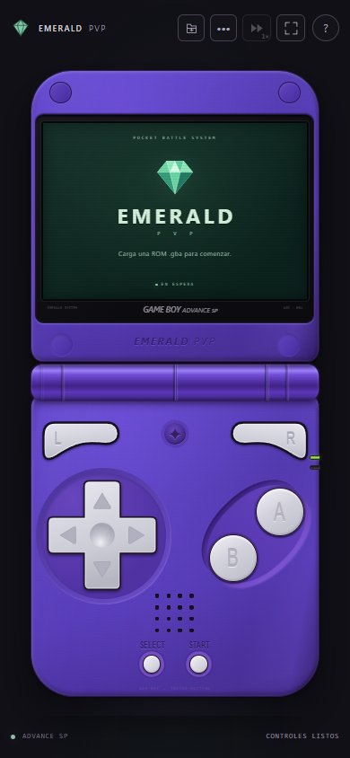
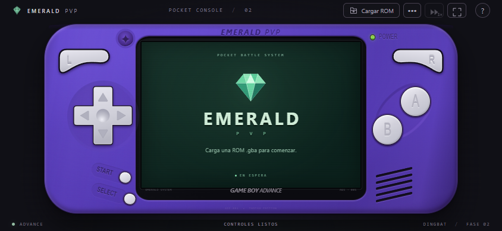

# Emerald PvP · 1.0.0-rc.1

Emulador GBA web con JavaScript vanilla, Dingbat WASM oficial y una consola morada responsive: Advance SP en vertical y Advance clásica en horizontal. Usa un único Canvas de 240 × 160, guardados locales y cable Link original sobre WebRTC, con salas de dos personas en Netlify Server.

**RC preparado para Deploy Preview.** Las pruebas locales pasan; faltan la validación remota de Admin Test y un combate completo de Pokémon Esmeralda. No se distribuyen juegos ni BIOS propietarios.

| Vertical · 390 × 844 | Horizontal · 844 × 390 |
| --- | --- |
|  |  |

Capturas del build actual, sin ROM ni credenciales. Las referencias originales permanecen en `references/portrait.jpg` y `references/landscape.jpg`, ignoradas y fuera del sitio.

## Entorno y desarrollo

Requiere Node.js 24 y npm existentes. No se necesitan compiladores, herramientas globales ni frameworks. En PowerShell puede usarse `npm.cmd` / `npx.cmd` si la política de scripts bloquea los comandos sin extensión.

```sh
npm ci
npx netlify dev --offline --no-open
```

Abrir **http://localhost:8888**: frontend y API juntos. `npm run dev:online` inicia Netlify Dev normalmente; `npm run dev` sirve solo fuentes en **5173**, sin API. Netlify Dev arranca ese mismo servidor: comprobar puertos y evitar ejecutarlo dos veces. No abrir el HTML como `file://`.

```sh
npm run build
npm run preview
```

El preview estático sirve `dist/` en **4173**, sin API. Para probar **el build y el servidor juntos**, detener los servidores propios anteriores y ejecutar:

```sh
npx netlify dev --offline --no-open --command "npm run preview" --target-port 4173 --port 8888
```

SHA-256 y otras APIs requieren HTTPS o localhost; HTTP por IP de LAN en un teléfono no equivale a localhost. Netlify proporciona HTTPS.

## Jugar y guardar

1. **Cargar ROM** abre una ROM local `.gba` válida de hasta 32 MiB. El núcleo se descarga solo al cargarla. El audio requiere un gesto del usuario.
2. **···** permite pausar, reanudar, reiniciar, importar y exportar batería `.sav`, silenciar y abrir salas. Reiniciar conserva la batería; importar un save reinicia para aplicarlo. Exportar copias de seguridad antes de reemplazar una partida.
3. Guardar dentro del juego. IndexedDB persiste la batería cuando cambia, aproximadamente cada dos segundos, y al pausar, cambiar de ROM u ocultar la página. La identidad es el SHA-256 de la ROM; renombrarla no cambia su partida.
4. **Recordar acceso a esta ROM local** exige autorización explícita. **Continuar** revalida el SHA-256 y solicita permiso o selección del mismo archivo cuando sea necesario. Solo se guarda identidad y, si el navegador lo permite, una referencia de lectura; nunca bytes de ROM. Desmarcar olvida el acceso y conserva los saves.
5. **⏩** alterna 1x/2x acelerando el scheduler real, con trabajo acotado. A 2x se silencia el audio. Reservar Link fuerza 1x y bloquea fast-forward, cambio de ROM, reset e importación.
6. **Pantalla completa** oculta elementos secundarios y conserva todos los controles y una salida visible. Usa Fullscreen API si se concede; el fallback CSS usa `100dvh` y safe areas. Safari iPhone no tiene fullscreen nativo garantizado. El mismo botón o Escape permiten salir.

Los saves admiten 512 B, 8/32/64/128 KiB y un RTC opcional de 16 B, sujetos al chip de la partida vigente. Se comprueban integridad y transacción de escritura. Un registro corrupto se conserva, bloquea el autoguardado y requiere importar explícitamente una copia válida. Sin IndexedDB se informa la limitación y sigue disponible la exportación. No hay save states ni rewind.

ROMs seleccionadas y progreso permanecen locales; no se suben al backend. Admin Test, opcional, descarga archivos autorizados desde un almacén privado. No sincroniza el progreso. Navegación privada, cuotas, borrado de datos o cierre forzado pueden perder almacenamiento o impedir la última escritura.

### Controles

| GBA | Teclado |
| --- | --- |
| Cruceta | Flechas o WASD |
| A / B | X / Z o K / J |
| L / R | Q / E |
| Start | Intro |
| Select | Mayúsculas o Retroceso |

Multitouch, cruceta deslizante, teclado y Gamepad estándar se agregan por fuente. Tab/Espacio permiten activar controles. Cancelar un puntero, perder captura/foco, ocultar la página, abrir diálogos o girar libera entradas sin soltar otra fuente activa.

Perder foco/visibilidad pausa CPU y audio. En individual se reanuda desde **···**; con Link se reanuda al regresar únicamente una pausa automática. Una pausa manual requiere reanudación explícita y detiene también al rival. Girar conserva Canvas, núcleo y memoria sin reiniciar.

## Salas y Link

En ambos dispositivos, cargar **exactamente la misma ROM (SHA-256)**; los saves pueden ser distintos. Abrir **··· → Salas**: el host crea y comparte el código de diez símbolos; el invitado se une. Se rechaza un tercer jugador. Pulsar **Conectar cable Link** en ambos antes de iniciar la conexión dentro del Club Cable del juego. Estar en una sala no significa tener el cable conectado.

El WebSocket permanece abierto para membresía y señales SDP/ICE. Un único DataChannel `link`, fiable, ordenado y binario, transporta el protocolo SIO original. No intercambia ROMs, BIOS, saves ni estados. El attach conserva la partida, usa lockstep sin rollback y mantiene CRC estricto; las incompatibilidades SHA/CRC sobreviven a cierres genéricos. Solo un frame completado avanza el reloj; un stall espera al rival.

Al desconectar se drena BYE y se vuelve a individual. Abandonar/cerrar como host invalida la sala; al salir el invitado queda libre su plaza. Tras caída/reinicio se descarta la membresía; la reconexión limitada no reproduce operaciones ni restaura salas.

**Red:** STUN vacío por defecto; configuración opcional mediante el array JSON `localStorage['emerald:link:stun']`, solo URL `stun:`/`stuns:`. No se añade ningún proveedor automáticamente. Sin TURN no se garantiza conectar entre NAT/CGNAT distintos. Una suspensión móvil dura puede cerrar sockets y exigir reconectar explícitamente.

### API de salas

`GET /api/health` devuelve salud, protocolo e instancia. `/api/signal` requiere upgrade WebSocket (426 sin upgrade), valida Origin de navegador y acepta JSON con `type` y `requestId` (1–64 caracteres alfanuméricos, `_` o `-`).

| Tipo | Campos | Efecto |
| --- | --- | --- |
| `create` | — | Crea sala; rol host asignado al socket |
| `join` | `code` | Se une como guest |
| `leave` | — | Abandona |
| `close` | — | Solo host; cierra para ambos |
| `signal` | `data`: objeto JSON | Solo al compañero de la misma sala |

Respuestas: `room`, `left`, `room-closed`, `ok`; errores `{ type: 'error', requestId, code, message }`. Al conectar se recibe `welcome`. Los roles/destinatarios no se aceptan del payload.

Por instancia: 200 conexiones, 8/IP, 100 salas; códigos seguros de 50 bits; mensajes de 16 KiB, profundidad 8, señales de hasta 512 valores y cola de 64 KiB. Ráfaga de 20 mensajes/socket con recarga de 10/s; crear/unirse admite 10 intentos/IP con recarga de 0,5/s. Excesos, binarios y receptores lentos se rechazan. El apagado notifica y cierra con 1012.

## Arquitectura

| Archivos | Responsabilidad |
| --- | --- |
| `public/index.html`, `style.css` | DOM/Canvas compartido, carcasas y diálogos |
| `js/main.js` | UI, archivos y ciclo de vida |
| `js/controls.js` | Única fuente de entradas; emite `emerald:input` |
| `js/emulator.js`, `storage.js` | Dingbat/MEMFS, scheduler, audio/Link ABI; IndexedDB/SHA-256 |
| `js/multiplayer.js`, `link.js` | Salas/señalización; negociación RTC y transporte binario |
| `js/immersive.js`, `admin.js` | Fullscreen/fallback; acceso privado y descargas |
| `netlify/server/{index,rooms,admin,password}.mjs` | Handler oficial, salas efímeras, autorización y scrypt |
| `scripts/`, `tests/` | Servidor estático, build/generador de credenciales y QA local |

Las rutas `js/` de la tabla son relativas a `public/`. No hay backend de emulación ni base de datos de partidas. Blobs conserva solo archivos privados autorizados y registros administrativos de sesión.

## Admin Test y Blobs

**Desactivado por defecto; el acceso público normal no exige credenciales.** El candado en **···** abre el formulario; el backend autoriza cada lectura. No existe uploader público.

Generar credenciales en una terminal interactiva, con contraseña nueva (mínimo 16 bytes); no se muestra ni se escribe a un archivo:

```sh
npm run admin:password
```

El comando imprime únicamente el hash scrypt y un secreto aleatorio para copiarlos a Netlify. No pegar esos valores en Git, README, logs de QA, frontend ni `netlify.toml`.

En el proyecto Netlify correcto configurar manualmente estas cuatro variables, **scope Functions, contexto Deploy Previews**:

| Variable | Valor |
| --- | --- |
| `EMERALD_ADMIN_ENABLED` | `true` |
| `EMERALD_ADMIN_PASSWORD_HASH` | Hash generado |
| `EMERALD_SESSION_SECRET` | Secreto generado |
| `EMERALD_PRIVATE_STORE` | `emerald-private-preview` |

En **Production**, dejar `EMERALD_ADMIN_ENABLED` ausente o `false`; no heredar el `true` de preview. Solo una habilitación explícita futura usaría credenciales separadas y `emerald-private-production`. Cambiar variables exige redesplegar: Server recibe valores con [scope Functions fijados por deploy](https://docs.netlify.com/build/server/configuration/#environment-variables).

El servidor selecciona el store por [`context.deploy.context`](https://docs.netlify.com/build/server/api/#deploy), y falla cerrado ante contexto desconocido o configuración cruzada. Dev usa los indicadores locales oficiales `NETLIFY_DEV`/`NETLIFY_LOCAL` y siempre preview; su `deploy.context` puede estar vacío. **Netlify Dev usa almacenamiento local aislado, no los objetos remotos.** Los stores de [`getStore` son compartidos por el sitio](https://docs.netlify.com/build/data-and-storage/netlify-blobs/#deploy-specific-stores): la separación preview/producción la impone este servidor.

### Validación remota con health.txt

Estos pasos son **manuales y escriben en el sitio vinculado**; no forman parte del build ni de las pruebas locales. Con la CLI ya autenticada, comprobar primero `npx netlify status` y confirmar el proyecto. Desde PowerShell:

```powershell
New-Item -ItemType Directory -Path artifacts -Force | Out-Null
Set-Content -LiteralPath artifacts/health.txt -Value 'Diagnostico privado correcto' -Encoding utf8
npx.cmd netlify blobs:set emerald-private-preview admin/health --input artifacts/health.txt
npx.cmd netlify blobs:get emerald-private-preview admin/health --output artifacts/health-received.txt
Get-Content -LiteralPath artifacts/health-received.txt
```

1. Abrir el **Deploy Preview por HTTPS**. Sin sesión, `/api/admin/health` debe devolver 401; con Admin desactivado devuelve 404.
2. Autenticarse desde el candado y pulsar **Verificar diagnóstico**: debe aparecer el texto. Revisar cookie `__Host-` con Secure/HttpOnly/SameSite=Strict, respuestas `private, no-store`, ausencia de URLs directas y rechazo de Origin/CSRF ajenos.
3. Cerrar sesión: la cookie anterior ya no debe autorizar nuevas lecturas. En producción, `/api/admin/health` siempre es 404; Admin desactivado tampoco expone los demás endpoints.
4. Eliminar únicamente el objeto de prueba y confirmar que deja de estar disponible:

```sh
npx netlify blobs:delete emerald-private-preview admin/health
```

Solo después, si se dispone de derechos para el uso remoto, las claves de archivos autorizados son `admin/rom` y `admin/save`. La CLI admite el mismo `blobs:set STORE KEY --input RUTA` y `blobs:delete STORE KEY`. No subir ni distribuir ROMs comerciales como parte del RC. `game_test/` sigue ignorado y nunca se lee durante el build.

**Cargar prueba** reutiliza el loader normal. Una partida local válida tiene prioridad sobre la plantilla; una corrupta no se reemplaza automáticamente. El servidor nunca escribe `admin/rom` ni `admin/save`. Logout revoca nuevas lecturas, conservando la emulación y el progreso ya cargados.

### Seguridad y límites

- Contraseñas: scrypt N=65536, r=8, p=1, sal de 16 B y clave de 32 B; comparaciones constantes. Máximo dos hashes concurrentes; login JSON acotado a 2 KiB/3 s, cuotas de cinco intentos/IP con recuperación de uno/minuto.
- Sesiones de 15 min, sid aleatorio de 32 B firmado con HMAC y ligado a origen/store/credencial. Cookie HttpOnly, SameSite Strict y Secure/`__Host-` en HTTPS; HTTP únicamente loopback local. Cada petición lee su registro en Blobs con consistencia fuerte; no hay caché de autorización. Logout elimina el registro antes de confirmar.
- Origin/Fetch Metadata y cabecera de login; CSRF para logout/binarios. CSRF solo en memoria; `sessionStorage` guarda únicamente un booleano de restauración, nunca contraseña ni token. Cookies falsificadas se rechazan antes de consultar Blobs.
- Rutas fijas: `/api/admin/{login,session,logout,rom,save,health}`. No se aceptan store, key ni query arbitrarios. Sin CORS público, URLs firmadas, logs de credenciales ni caché pública.
- Lecturas autenticadas por stream: ROM hasta 32 MiB, save hasta 131088 B, diagnóstico hasta 1 KiB; 15 s sin datos/120 s totales. El frontend también cuenta bytes y termina/valida antes de cargar; nunca inicia descargas parciales.
- Rate limiting por instancia/IP, no distribuido; se reinicia al reemplazar el servidor. Rotar secreto o hash y redesplegar revoca globalmente. Los registros caducados se eliminan al consultarlos; los huérfanos se limpian manualmente en Blobs, dentro de `admin/sessions/`.

## Pruebas y métricas del RC

Con Netlify Dev sirviendo preview en 4173/8888 mediante el comando anterior, ejecutar consecutivamente:

```sh
npm run check
npm test
npm run build
npm run test:online
npm run test:link
npm run test:experience
npm run test:admin
```

| Comando | Resultado local |
| --- | --- |
| `check` | Sintaxis correcta |
| `test` | 38/38; hashes oficiales, seguridad, salas, negociación y dos builds idénticos |
| `build` | 15 archivos permitidos en dist |
| `test:online` | 8/8; WebSockets reales, aislamiento, cuotas y desconexión |
| `test:link` | 8/8; cuatro diagnósticos MIT, 16 intercambios por ROM, IRQ/EWRAM, stalls, SHA/CRC y retorno individual |
| `test:experience` | 7/7; 1x/2x, controles, foco/rotación, fullscreen, IndexedDB y build minificado |
| `test:admin` | 4/4; SDK Blobs real local, texto/binarios, reinicios, revocación y navegador |

QA usa el Chrome instalado (`CHROME_PATH` opcional), perfiles aislados y evidencia en `artifacts/`. No instala navegador/framework. El Gamepad de QA es inyectado. Admin usa `@netlify/dev` ya transitivo de la CLI y un sandbox loopback propio con secretos efímeros y archivos legales generados; las unidades de seguridad sí usan mocks. Ninguna suite usa stores personales/cloud ni saves del usuario.

Build: **1.181.933 → 1.139.552 B**, gzip estimado **373.760 B**, Brotli estimado **289.532 B**. esbuild transforma solo JS/CSS propios, sin bundle ni sourcemaps; conserva fuente legible, rutas, núcleo y licencias. No incluye tests, referencias, archivos privados ni variables del entorno. Núcleo diferido hasta cargar ROM; no se solicitan APIs privadas en la primera visita pública. HTTP revalida rutas estables, sin service worker ni `immutable`; conserva CSP WASM/WebSocket y MIME `application/wasm`.

Chrome local, cinco cargas del build con caché HTTP vaciada: documento **54,7–219,3 ms**, mediana **163,5 ms**; solicitud de arranque a frame diagnóstico **35,6–522,3 ms**, mediana **37,9 ms** (la primera incluye compilación fría). No son mediciones de red móvil/CDN. Una comparación histórica empeoró de 163 a 233 ms pese a reducir bytes; no se afirma que minificar mejore automáticamente la carga. Este cierre no añade optimizaciones funcionales.

Auditoría npm: **0 vulnerabilidades de producción**; árbol de desarrollo con **15 avisos (13 moderados, 2 bajos)** en dependencias de la CLI. No se aplica `audit fix --force`: propone degradar Netlify CLI a una versión incompatible con Server. Pendiente actualización compatible del proveedor.

## Licencias y procedencia

[Dingbat](https://github.com/mattrbeck/dingbat), Matthew Beck, MIT, fijado en `91709f81223ee6a8be61e251466a7d748141d458`. `public/core/em.js` y `em.wasm` oficiales permanecen intactos; hashes/procedencia y avisos en [core/README](public/core/README.md), [LICENSE](public/core/LICENSE) y [THIRD_PARTY_NOTICES](public/core/THIRD_PARTY_NOTICES.md). El hash de JS se verifica con LF canónico para tolerar CRLF de Git.

Los cuatro [diagnósticos Link originales](tests/fixtures/link/README.md) conservan hashes y [licencia MIT](tests/fixtures/link/LICENSE). El harness carga esos programas sin cabecera en MEMFS aislado; la validación de producción no se debilita. No se incluyen ROMs comerciales ni BIOS. Proyecto independiente, sin afiliación con Nintendo, Game Freak o The Pokémon Company.

## Preparar Deploy Preview y actualizar PR #1

`netlify.toml`: Node 24, build `npm run build`, publicación `dist/`, Server `/api/*`, escala máxima 1. No hay rewrite SPA que oculte la API. Las salas son efímeras: reinicios/despliegues pierden membresías; instancias solapadas durante reemplazos pueden devolver `ROOM_NOT_FOUND` incluso con ese máximo. Netlify Server está en Early Access.

1. Revisar `git branch --show-current`, `git status --short`, `git diff --check` y `git diff`; debe mantenerse `feat/online-pvp`. Inspeccionar también los archivos nuevos. No incluir `.env*`, `game_test/`, ROMs/saves personales ni `artifacts/`.
2. El trabajo de las fases A/B sigue pendiente de commit, incluidos módulos/tests nuevos: conservarlo completo. Tras revisión, **el usuario** puede preparar estos archivos públicos:
   ```sh
   git add .gitignore AGENTS.md README.md package.json package-lock.json netlify.toml public netlify/server scripts tests docs
   git diff --cached --check
   git diff --cached --stat
   git diff --cached
   git commit -m "chore: prepare Emerald PvP 1.0.0-rc.1"
   git push origin feat/online-pvp
   ```
3. Ese push actualizará el [PR #1 existente](https://github.com/bobyDeveloper/Pokemon-esmeralda-pvp-emulator/pull/1) si su head sigue siendo esta rama del repositorio; comprobar base `main` y head antes. No crear otro PR, tag, force-push ni merge. Título sugerido: **Emerald PvP 1.0.0-rc.1: experiencia, Link y Admin Test privado**. Descripción: resumir A/B, resultados de la tabla y validaciones pendientes.
4. Configurar las cuatro variables de preview, manteniendo Admin desactivado en producción. Revisar el Deploy Preview del PR tras el push autorizado; comprobar frontend, `/api/health`, salas de dos clientes, WASM/CSP y diagnóstico `health.txt` antes de usar archivos privados.

**Pendiente antes de declarar v1.0.0 final:** Safari iPhone, Android físicos, audio/safe areas, suspensión/reanudación móvil, Gamepad físico, NAT distintos, cookies HTTPS/Blobs remoto y latencia/streams/CDN reales. Para el combate: usar dos ROMs locales con SHA-256 idéntico y saves propios con acceso al Club Cable, conectar sala y cable en ambos, completar un combate, salir normalmente y comprobar exportación/recarga de cada save. Los diagnósticos no sustituyen esa prueba.

No se ejecutaron commits, pushes, tags, subidas cloud ni despliegues durante la auditoría.
